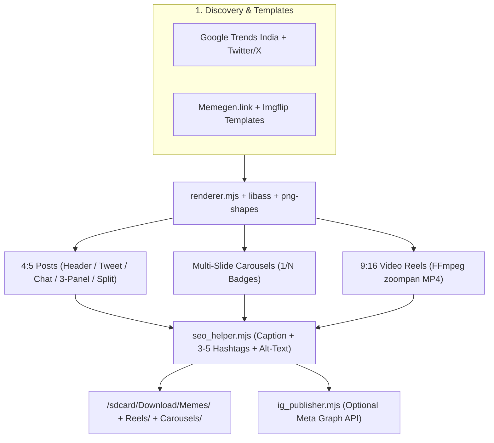

# 🚀 MemesStudio v3.0 — Autonomous Indian Viral Meme & Reels Studio

> **Real-time Google + Twitter/X Trends · 9:16 Video Reels (`zoompan`) · Tweet Cards · WhatsApp Fake Chats · 3-Panel Comics · Multi-Slide Carousels · Hindi Devanagari + Montserrat Black 900 · Free Template API · Instagram SEO & Graph API Publisher.**

[](https://opensource.org/licenses/MIT)
[](https://github.com/sagarku03/MemesStudio/releases)
[](https://github.com/sagarku03/MemesStudio/actions)
[](https://nodejs.org)
[](https://modelcontextprotocol.io)

---

## ⚡ Zero-Friction One-Command Setup

No manual configuration needed! The automated setup script handles everything:
- ✅ **Dynamic Paths:** Auto-detects wherever the repo is cloned.
- ✅ **Auto-Installs FFmpeg:** Detects Termux (`pkg install ffmpeg`), Debian/Ubuntu (`apt`), macOS (`brew`).
- ✅ **Auto-Registers MCP:** Automatically adds `meme_studio_mcp` (15 tools) to `mcp_config.json`.
- ✅ **Auto-Installs Skill:** Copies `SKILL.md` directly into agent skills directory.
- ✅ **Creates Output Folders:** Ready-to-use `/sdcard/Download/Memes`, `Carousels/`, and `Reels/`.

### 1️⃣ Option 1: One-Line Installer (Recommended)
```bash
curl -sL https://raw.githubusercontent.com/sagarku03/MemesStudio/main/install.sh | bash
```

### 2️⃣ Option 2: Clone & Run Setup
```bash
git clone https://github.com/sagarku03/MemesStudio.git
cd MemesStudio
./setup.sh
```

---

## 🔥 What's New in v3.0

- **🎬 9:16 Instagram Reel Video Memes (`meme_render_reel`):** Converts any meme into a 1080×1920 looping MP4 with smooth FFmpeg `zoompan` Ken Burns motion, Instagram safe-zone layout, and optional BGM/SFX audio (or silent MP4 ready for IG Trending Audio).
- **🐦 X / Twitter Card Generator (`meme_render_tweet_card`):** Authentic Dark/Light tweet cards with circular avatar, verified blue badge, wrapped Hinglish/Hindi text, and bottom reaction image.
- **💬 Fake Chat Generator (`meme_render_fake_chat`):** WhatsApp Dark, WhatsApp Light, and iMessage bubble templates with auto-wrapped bubbles + reaction photo.
- **🎭 3-Panel Comic Layout (`meme_render_three_panel`):** Stacked 3-panel storytelling with heavy outlined captions.
- **🇮🇳 Mixed Hindi (Devanagari) + Hinglish Auto-Wrap:** Powered by FFmpeg `libass` with bundled `Montserrat-Black` + `NotoSansDevanagari-Black` + `Inter` fonts — long captions wrap cleanly and Hindi never breaks!
- **🌐 Free Template Library (`meme_fetch_templates` & `meme_download_template`):** Integrated with **Memegen.link** & **Imgflip** (zero auth required, 24h local cache).
- **📈 2025–2026 Instagram SEO (`meme_generate_seo`):** Auto-generates DM-share trigger captions, **3–5 targeted hashtags** (no spam penalty), SEO alt-text, and saves `_caption.txt` sidecars.
- **🤖 Daily Autopilot (`npm run autopilot`):** Automatically fetches live safe India trends, pulls matching templates, and renders both a 4:5 Post + 9:16 Reel + Caption file.
- **📤 Instagram Graph API Publisher (`meme_publish_instagram`):** Direct publishing support for Images, Carousels (up to 10 slides), and Reels.

---

## 🏗️ Architecture



---

## 🛠️ Complete MCP Tools Reference (15 Tools)

| Category | Tool Name | Purpose |
| :--- | :--- | :--- |
| **Trends** | `meme_fetch_all_trends` | Combined Google Trends + Twitter/X India trends |
| **Trends** | `meme_fetch_india_trends` | Google Trends India real-time searches |
| **Trends** | `meme_fetch_twitter_trends` | Twitter/X India trending hashtags |
| **Templates** | `meme_fetch_templates` | Search 100+ free Memegen.link & Imgflip templates |
| **Templates** | `meme_download_template` | Download blank template image locally |
| **Posts** | `meme_render_yellow_header` | 1080×1350 Yellow/Dark/Light header meme (Hindi+English) |
| **Posts** | `meme_render_tweet_card` | 1080×1350 X/Twitter card meme + verified badge |
| **Posts** | `meme_render_fake_chat` | 1080×1350 WhatsApp / iMessage fake chat meme |
| **Posts** | `meme_render_three_panel` | 1080×1350 3-panel stacked comic dialogue meme |
| **Posts** | `meme_render_comparison` | 1080×1350 Left vs Right dual-column comparison |
| **Posts** | `meme_render_split` | 1080×1350 Top vs Bottom split meme |
| **Albums** | `meme_render_carousel` | 2–20 slide swipeable carousel album (`1/N` badges) |
| **Video** | `meme_render_reel` | 1080×1920 9:16 MP4 video meme with `zoompan` + audio |
| **Growth** | `meme_generate_seo` | DM-share caption, 3–5 hashtags, alt-text & IST windows |
| **Publish** | `meme_publish_instagram` | Official Meta Instagram Graph API v21.0 publisher |

---

## 📂 Project Structure

```
MemesStudio/
├── setup.sh / setup.mjs / install.sh   # 1-Click Installer & Auto-Config
├── mcp-server.mjs                      # JSON-RPC Stdio MCP Server (15 Tools)
├── renderer.mjs                        # FFmpeg + libass Rendering Engine
├── trend_hunter.mjs                    # Multi-Source India Trend Hunter
├── template_fetcher.mjs                # Memegen.link + Imgflip Template Client
├── seo_helper.mjs                      # 2025-2026 Instagram SEO & Captions
├── ig_publisher.mjs                    # Meta Graph API Publisher
├── lib/
│   ├── ass-builder.mjs                 # Mixed Hindi/Latin ASS + Word-Wrap
│   └── png-shapes.mjs                  # Zero-Dep Antialiased PNG Generator
├── scripts/
│   ├── autopilot.mjs                   # Daily Trend-to-Meme+Reel Autopilot
│   └── bump-version.mjs                # SemVer Auto-Bump Script
├── assets/
│   ├── fonts/                          # Montserrat-Black, NotoSansDevanagari-Black, Inter, Poppins
│   └── emojis/                         # 15 Twemoji 3D PNG assets
└── SKILL.md
```

---

## 📄 License

MIT License © 2026 [sagarku03](https://github.com/sagarku03).
