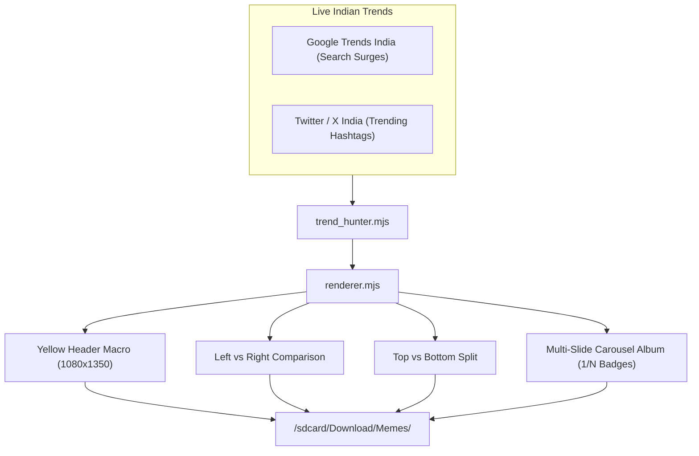

# 🚀 MemesStudio — Autonomous Indian Viral Meme Studio

> **Real-time Trend Hunting (Google + Twitter/X) · Montserrat Black 900 Typography · Dual-Color Contrast · iOS 3D Emojis · Multi-Slide Carousels · 0.5s FFmpeg Rendering for Instagram.**

[](https://opensource.org/licenses/MIT)
[](https://nodejs.org)
[](https://modelcontextprotocol.io)
[-purple.svg)](https://instagram.com)

---

## ⚡ Zero-Friction One-Command Setup

No manual configuration needed! The automated setup script handles everything:
- ✅ **Dynamic Paths:** Auto-detects wherever the repo is cloned.
- ✅ **Auto-Installs FFmpeg:** Detects Termux (`pkg install ffmpeg`), Debian/Ubuntu (`apt`), macOS (`brew`).
- ✅ **Auto-Registers MCP:** Automatically adds `meme_studio_mcp` to `mcp_config.json`.
- ✅ **Auto-Installs Skill:** Copies `SKILL.md` directly into the agent skills directory.
- ✅ **Creates Output Folders:** Ready-to-use `/sdcard/Download/Memes` & `Carousels`.

### 1️⃣ Option 1: One-Line Installer (Recommended)
```bash
curl -sL https://raw.githubusercontent.com/sagarku03/MemesStudio/main/install.sh | bash
```

### 2️⃣ Option 2: Clone & Run Setup
```bash
git clone https://github.com/sagarku03/MemesStudio.git
cd MemesStudio
./setup.sh
```

---

## 📸 Key Features

- **🔥 Multi-Source Trend Hunter:** Real-time search surges directly from **Google Trends India** and **Twitter / X India** (via Trends24).
- **⚡ 0.5-Second FFmpeg Rendering:** Instant generation of 1080×1350 (4:5) Instagram-ready graphics.
- **🎨 High-Impact Typography:** Bundled **Montserrat-Black (900 Weight)** and **Poppins-Black** for punchy, bold readability.
- **🎯 Psychology-Engineered Two-Tone Headers:**
  - **Line 1 (Hook):** Jet Black (`#000000`)
  - **Line 2 (Punchline):** Crimson Red (`#D32F2F`)
- **😀 Apple iOS 3D Emojis Pack:** Pre-bundled glossy emoji assets (`😂`, `😭`, `💀`, `🤤`, `💸`, `🔥`, `😈`, `😏`, `👀`).
- **📱 Multi-Slide Instagram Carousels:** Full album generation with automatic `1/N ->` badges and dedicated gallery export.
- **🔒 Anti-Theft Watermarking:** Translucent pill badge (`@soo_funny_memes` or your custom handle) positioned to prevent cropping.
- **🤖 Universal MCP Server:** Compatible with AntiGem, Claude Desktop, Cursor, or any Model Context Protocol host.

---

## 🏗️ Architecture



---

## 🛠️ MCP Tools Reference

| Tool Name | Parameters | Description |
| :--- | :--- | :--- |
| `meme_fetch_all_trends` | `limit_per_source: number` | Fetches aggregated Google Trends + Twitter/X India trends. |
| `meme_fetch_twitter_trends` | `limit: number` | Fetches real-time Twitter/X trending hashtags in India. |
| `meme_fetch_india_trends` | `limit: number` | Fetches Google Trends India search queries. |
| `meme_render_yellow_header` | `image_path, hook_text, punchline_text, emoji, watermark` | Renders classic yellow-header 1080×1350 meme in 0.5s. |
| `meme_render_carousel` | `album_title, slides: [...], watermark` | Renders multi-slide swipeable Instagram carousel pack. |
| `meme_render_comparison` | `left_image, right_image, left_label, right_label, header_title, emoji` | Renders dual-column Left vs Right comparison meme. |
| `meme_render_split` | `top_image, bottom_image, top_label, bottom_label` | Renders Top vs Bottom expectation vs reality meme. |

---

## 📂 Project Structure

```
MemesStudio/
├── setup.sh             # 1-Click Setup Shell Script
├── setup.mjs            # Auto-installer & Configurator (Node.js)
├── install.sh           # One-line curl installer
├── mcp-server.mjs       # JSON-RPC Stdio MCP Server
├── renderer.mjs         # High-speed FFmpeg Rendering Engine (Dynamic Paths)
├── trend_hunter.mjs     # Multi-Source Trend Hunter
├── SKILL.md             # Complete viral meme copywriting skill rules
├── package.json         # Node.js project manifest
├── assets/
│   ├── fonts/           # Montserrat-Black.ttf, Poppins-Black.ttf
│   └── emojis/          # Apple iOS 3D emojis (joy, sob, skull, etc.)
└── README.md
```

---

## 📄 License

MIT License © 2026 [sagarku03](https://github.com/sagarku03).
